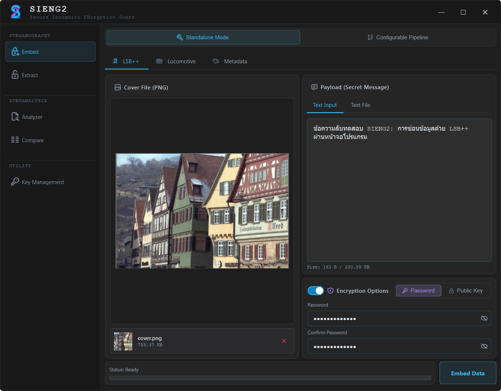
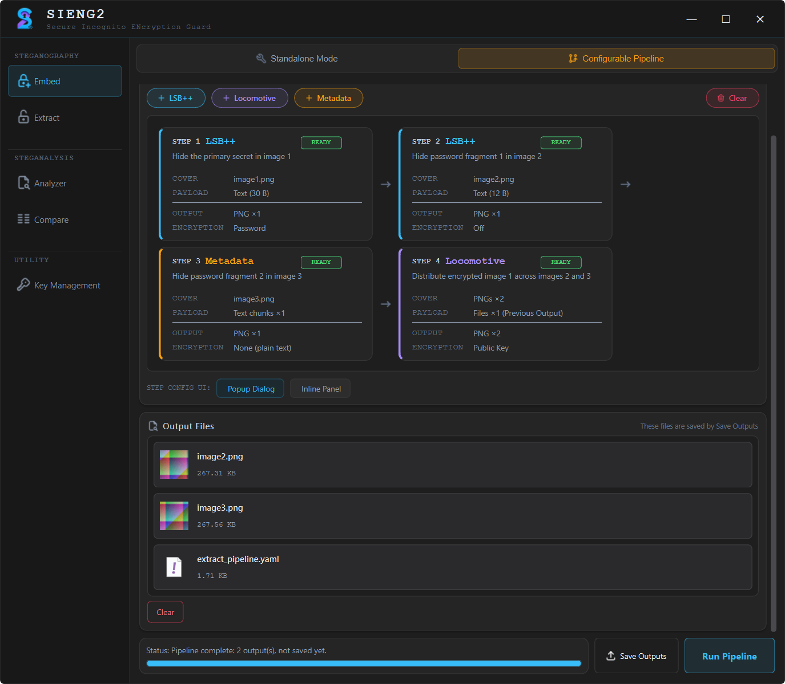
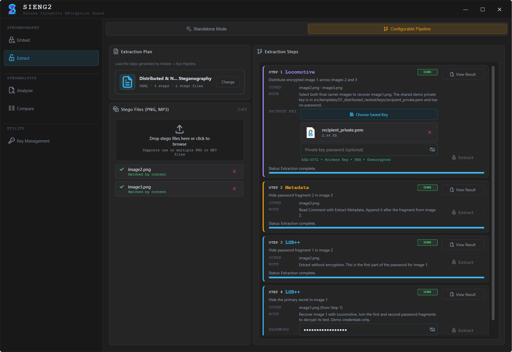
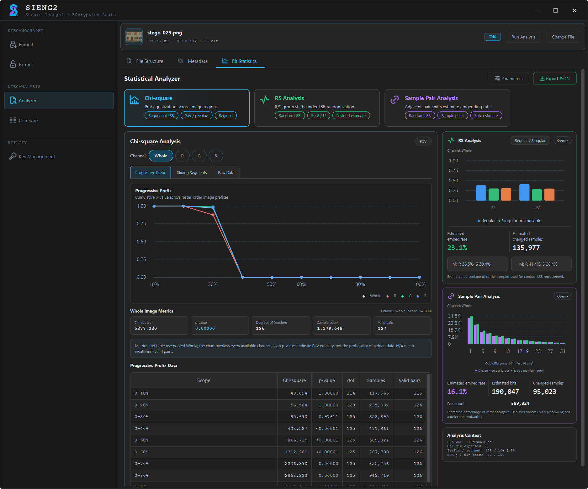

# เซี้ยง2 (SIENG2): Secure Incognito ENcryption Guard

**โปรแกรมป้องกันข้อมูลด้วยการแฝงตัวและเข้ารหัสแบบมั่นคง**

SIENG2 เป็นโปรแกรมบน Desktop (ทั้ง Windows และ Linux) สำหรับซ่อนข้อความหรือไฟล์ไว้ในไฟล์ภาพและไฟล์เสียง (Steganography) โดยเข้ารหัสข้อมูลก่อนซ่อนได้ และมีเครื่องมือวิเคราะห์ไฟล์เพื่อหาร่องรอยการซ่อนข้อมูล (Steganalysis) ในโปรแกรมเดียวกัน



---

## ความสามารถหลัก

| กลุ่ม | ทำอะไรได้ |
|---|---|
| **ซ่อนและสกัดข้อมูล** | ซ่อนข้อความหรือไฟล์ด้วย 3 เทคนิค (LSB++, Locomotive, Metadata) และสกัดกลับด้วยรหัสผ่านหรือกุญแจส่วนตัว |
| **Configurable Pipeline** | ต่อหลายเทคนิคเป็นลำดับขั้น ซ่อนซ้อนหลายชั้นหรือกระจายไว้หลายไฟล์ และสร้างแผนสกัดให้ผู้รับโดยอัตโนมัติ |
| **เข้ารหัส** | เข้ารหัสด้วยรหัสผ่าน (AES-256-GCM + Argon2id) หรือกุญแจสาธารณะ (RSA-OAEP ร่วมกับ AES-256-GCM) |
| **จัดการกุญแจ** | สร้างและจัดเก็บคู่กุญแจ RSA (2048 / 3072 / 4096 บิต) ภายในโปรแกรม |
| **วิเคราะห์ไฟล์** | ตรวจสถิติระดับบิต (Chi-square, RS Analysis, SPA) ของ PNG, WAV, AVI และตรวจโครงสร้างไฟล์และข้อมูลกำกับของ PNG, WAV, AVI, MP3 |

## เทคนิคการซ่อนข้อมูล

| เทคนิค | ไฟล์พาหะ | ซ่อนข้อมูลไว้ที่ไหน | เข้ารหัส | จุดเด่น |
|---|---|---|:-:|---|
| **LSB++** | ภาพ PNG, JPG, BMP, TIFF, WebP, ICO (ผลลัพธ์เป็น PNG) | บิตล่างของพิกเซล เลือกเฉพาะบริเวณที่มีรายละเอียด | ได้ | ภาพแทบไม่เปลี่ยน ลดร่องรอยทางสถิติด้วยการวิเคราะห์พื้นผิว สุ่มลำดับพิกเซล และปรับค่าพิกเซล (OPAP) |
| **Locomotive** | ภาพ PNG หนึ่งไฟล์หรือหลายไฟล์ | ต่อท้ายไฟล์หลังส่วนสิ้นสุดของ PNG | ได้ | ซ่อนไฟล์ขนาดใหญ่ได้ แบ่งข้อมูลกระจายไว้หลายภาพ และซ้อนหลายชั้นในไฟล์เดียวได้ ไม่แก้พิกเซล |
| **Metadata** | ภาพ PNG และเสียง MP3 | ฟิลด์ข้อมูลกำกับของไฟล์ (PNG Text Chunk / MP3 ID3) | ไม่ได้ | แก้ไขฟิลด์ผ่านหน้าจอได้ ไม่แก้พิกเซลหรือเสียง |

## Configurable Pipeline

ผู้ใช้เรียงเทคนิคเป็นขั้น แล้วใช้ไฟล์ผลลัพธ์ของขั้นก่อนหน้าเป็นข้อมูลนำเข้าของขั้นถัดไปได้ เช่น ซ่อนข้อความในภาพ A ด้วย LSB++ แล้วซ่อนภาพ A ทั้งไฟล์ไว้ในภาพ B ด้วย Locomotive (หัวรถจักร) ที่ใช้พ่วงข้อมูลต่อท้ายไฟล์ 

เมื่อรันเสร็จ โปรแกรมบันทึก **ไฟล์สุดท้าย** และ **แผนสกัด** (`extract_pipeline.yaml`) ให้ส่งต่อผู้รับ แผนบอกว่าต้องสกัดขั้นใดก่อนและต้องใช้ไฟล์ใด โดย**ไม่เก็บรหัสผ่านหรือข้อความลับ** ผู้รับเปิดแผน ใส่ไฟล์ แล้วสกัดทีละขั้นตามที่โปรแกรมแสดง

สายงานบันทึกเป็นไฟล์ YAML เพื่อนำกลับมาใช้ได้ และมีแม่แบบสำเร็จรูป 2 แบบให้ทดลอง

| ฝั่งผู้ส่ง (Embed) | ฝั่งผู้รับ (Extract) |
|---|---|
|  |  |

## การวิเคราะห์ไฟล์ (Analyzer)

- **Bit Statistics:** ตรวจร่องรอยการซ่อนในบิตล่างด้วย Chi-square, RS Analysis และ SPA สำหรับ PNG, WAV และ AVI
- **File Structure และ Metadata:** แสดงโครงสร้างไฟล์ ข้อมูลกำกับ และข้อมูลที่ต่อท้ายไฟล์ โดยตรวจภายใน Docker ที่ไม่มีการเชื่อมต่อเครือข่าย และเปิดไฟล์แบบอ่านอย่างเดียว



---

## เริ่มต้นใช้งาน

### สิ่งที่ต้องมี
- Windows 10/11 (พัฒนาและทดสอบบน Windows)
- Python 3.12
- Docker Desktop (ต้องมีเฉพาะเมื่อใช้แท็บ File Structure และ Metadata ของ Analyzer)

### ติดตั้ง
```bash
git clone https://github.com/GamesAgain/SIENG2.git
cd SIENG2
python -m venv venv
venv\Scripts\activate
pip install -r requirements.txt
```

### เปิดโปรแกรม
```bash
python main.py
```

### สร้างอิมเมจสำหรับตรวจโครงสร้างไฟล์ (ทำครั้งเดียว)
รันจากโฟลเดอร์หลักของโปรเจกต์
```bash
docker build -f docker/analyzer/Dockerfile -t sieng2-inspector .
```

## ทดลองใช้ด้วยแม่แบบ

1. ไปที่ **Embed → Configurable Pipeline** แล้วเลือกแม่แบบจากรายการ
   - **Distributed & Nested Steganography** ซ่อนข้อความลับในภาพ แล้วแบ่งรหัสผ่านเก็บไว้ในภาพอีก 2 ภาพ
   - **Nested Concealment & Cross-Media Key Distribution** ซ่อนไฟล์ PDF กระจายในภาพ แล้วเก็บรหัสผ่านไว้ใน Metadata ของภาพและไฟล์ MP3
2. กด **Run Pipeline** แล้ว **Save Outputs**
3. ไปที่ **Extract → Configurable Pipeline** เปิดไฟล์ `extract_pipeline.yaml` ใส่ไฟล์สุดท้าย แล้วสกัดทีละขั้นตามคำแนะนำ

รหัสผ่านและกุญแจตัวอย่างอยู่ในโฟลเดอร์ `src/templates/` (อ่านไฟล์ `README.md` ของแต่ละแม่แบบ) **ใช้เพื่อทดลองเท่านั้น ห้ามใช้กับข้อมูลจริง**

## โครงสร้างโปรเจกต์

```
SIENG2/
├── main.py                 จุดเริ่มต้นของโปรแกรม
├── requirements.txt        ไลบรารีที่ต้องใช้
├── docker/analyzer/        อิมเมจสำหรับตรวจโครงสร้างไฟล์ (sieng2-inspector)
└── src/
    ├── core/
    │   ├── stego/          เทคนิค LSB++, Locomotive และ Metadata (PNG, MP3)
    │   ├── crypto/         การเข้ารหัสด้วยรหัสผ่าน กุญแจสาธารณะ และการจัดการกุญแจ
    │   ├── configurable/   Configurable Pipeline และแผนสกัด
    │   └── analyzer/       การวิเคราะห์ไฟล์ (Chi-square, RS, SPA และการตรวจโครงสร้าง)
    ├── gui/                หน้าจอโปรแกรม (Embed, Extract, Analyzer, Key Management)
    └── templates/          แม่แบบ Pipeline พร้อมไฟล์ตัวอย่าง
```

## ข้อจำกัด

- ข้อมูลที่ซ่อนไว้**ไม่ทนต่อการบีบอัดหรือแปลงไฟล์ใหม่** เมื่อส่งผ่านแอปแชตหรือโซเชียลมีเดียแบบรูปภาพ ข้อมูลมักหาย ให้ส่งแบบไฟล์ (ไม่บีบอัด) หรือผ่านบริการเก็บไฟล์
- Locomotive และ Metadata ไม่แก้พิกเซล แต่**ตรวจพบได้จากการดูโครงสร้างไฟล์** (ข้อมูลต่อท้ายไฟล์ และฟิลด์ข้อมูลกำกับ)
- Metadata **ไม่มีการเข้ารหัสในตัว** ฟิลด์ที่ซ่อนอ่านได้ด้วยเครื่องมืออ่าน Metadata ทั่วไป
- แผนสกัดของ Configurable Pipeline แสดงเทคนิคและรูปแบบการเข้ารหัสของแต่ละขั้น (แต่ไม่มีรหัสผ่าน)

## ผู้จัดทำ

| | |
|---|---|
| **ผู้จัดทำ** | นายสรายุทธ บุตรวงษ์ |
| | นางสาวเพ็ญพิชชา ดวงตา |
| **อาจารย์ที่ปรึกษา** | ผศ.ดร. สมนึก พ่วงพรพิทักษ์ |

โครงงานปริญญานิพนธ์ หลักสูตรวิทยาศาสตรบัณฑิต สาขาวิชาวิทยาการคอมพิวเตอร์ คณะวิทยาการสารสนเทศ มหาวิทยาลัยมหาสารคาม ปีการศึกษา 2569
